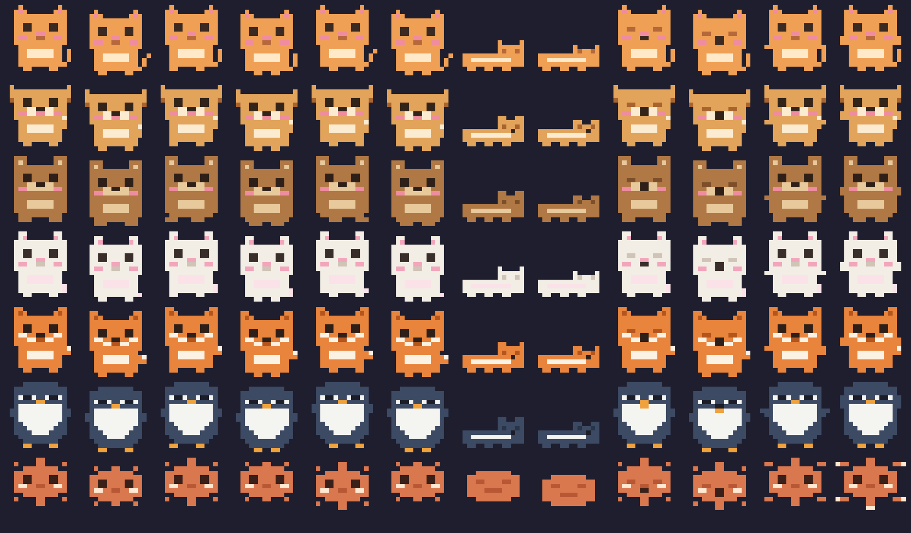

# Claude Pet 🐾

> A floating 8-bit pixel pet that shows your **Claude usage** (5-hour, weekly & model-scoped limits, plus extra usage) and changes its mood as you burn through your quota.
> 一只悬浮的 8-bit 像素桌宠，实时显示你的 **Claude 用量**（5 小时 / 每周 / 模型专属额度，以及额外用量），并随着额度消耗切换心情。

**English** · [中文](#中文教程)



7 pets to raise — 🐱 小橘 / 🐶 柴柴 / 🐻 布朗 / 🐰 团子 / 🦊 小狐 / 🐧 QQ / ✦ 小克

---

## English

### What is this?

Claude Pet keeps a tiny pixel companion on your screen. It reads your local Claude Code credentials, polls Anthropic's usage endpoint, and turns the numbers into a mood:

| Usage (worst of 5h / week / model-scoped ✦) | Mood | Behaviour |
| --- | --- | --- |
| < 40% | 😺 happy | strolls & chats happily |
| 40–70% | 🙂 calm | wanders lazily |
| 70–90% | 😴 sleepy | slows down, warns you |
| 90–99% | 😰 anxious | paces fast |
| plan limits dry, **usage credits** carrying the load | 💸 overage | keeps working, paces, nags about the bill |
| ≥ 99% (or a locked window) | 💤 depleted | sleeps until reset |
| no credentials | ❓ lost | confused |

It comes in two flavours:

- **Desktop** ([`desktop/`](desktop/)) — a transparent, always-on-top, click-through floating pet for **macOS & Windows** (Electron).
- **Mobile / Web** ([`web/`](web/)) — the same pets as an installable **PWA** for your phone.

### Desktop — quick start (needs [Node.js](https://nodejs.org) 22+; macOS 13+ or Windows 10/11 x64)

**macOS**
```bash
cd desktop
npm install     # first time only
npm start       # the first launch downloads the Electron binary (~1–2 min)
```
Next time just double-click `desktop/启动桌宠.command`.

**Windows**
Double-click **`desktop/启动桌宠.bat`** (it runs `npm install` for you the first time), or:
```bat
cd desktop
npm install
npm start
```

### Using the desktop pet

- **Hover** the pet → usage panel (5h / weekly bars + reset countdown)
- **Drag** it anywhere; it only walks horizontally
- **Click** → pet it; **double-click** → take a rest
- **Tray icon** (menu bar on macOS / system tray on Windows) or **right-click** the pet → switch character, size, auto-start, refresh, quit
- ◀ ▶ in the panel cycles through all pets
- Pets now really **walk** (4-frame gait) and occasionally stop to **yawn** 🥱 or **stretch** — sleepier pets yawn more

### Model-scoped limits (Fable ✦), usage credits 💸 and where your week went

Claude's usage API (as of Oct 2026) reports a structured list of limits instead of two plain numbers, and the pet reads all of it:

- **5h / weekly** — the session window and the weekly all-models window (the one currently binding is what `claude`'s `/usage` lists first).
- **Model-scoped weekly windows** — e.g. the **Fable ✦** weekly limit on Max / Team Premium plans (Fable 5.1 and Mythos 5.1 share it; it's a share of the weekly allowance — hover the label to see the share). Each scoped window gets its own bar — violet for Fable, teal for anything else — labelled straight from the API, so a newly scoped model shows up without an app update. Fable keeps its dedicated **80% / 95%** notifications and reset celebration, and the tray tooltip lists every window.
- **Usage credits 💸** (the API calls them "extra usage") — if you've enabled them, a gold bar shows how much of your monthly spend limit you've burned (plus the amount). When the plan limits are dry but credits are carrying the load ("Now using credits" in Claude Code), the pet doesn't fall asleep: it enters the **overage** mood, paces, nags about the bill, and notifies you at **80% / 95%** of the spend limit.
- **This week** — a one-liner of where the weekly usage went (Claude Code / Chats / Cowork / Other).
- **Locks** — if a window is locked (e.g. by an org policy) the HUD says so instead of showing a misleading countdown.

### 🌱 Pixel garden & 📈 quota weather

- **Pixel garden** — three plots live under the usage bars (and in the Dynamic Island's lower area). Click an empty plot to plant; carrots 🥕, tomatoes 🍅 and sunflowers 🌻 grow at the pace of the pet's mood: a happy, well-rationed Claude means a thriving garden, burning through the quota stalls it, and a depleted quota leaves the plants thirsty 💧. Every reset waters them. Ripe crops glow — click to harvest and feed the pet (10 harvests unlock the 🌱 *Harvest Master* medal). Toggle it in Settings → Features.
- **Trend sparklines + forecast** — the HUD keeps 7 days of history and draws two 8-bit sparklines (5h window over 6 hours, weekly over 7 days). A burn-rate forecast tells you whether you'll make it to the reset at the current pace: ☀️ fine · 🌤 tight · 🌧 runs dry before the reset · ⛈ running dry fast — and the pet nags you about the pace when it turns bad.

### Track OTHER agents too (Codex / OpenClaw 🦞 / anything)

Claude isn't the only thing burning tokens. In **Settings → Usage sources** you can enable:

| Source | How it works |
| --- | --- |
| **Claude** (default) | local Claude Code credentials → official usage numbers |
| **Codex** | reads OpenAI Codex CLI's local session logs (`~/.codex`) — no login, no network |
| **OpenClaw 🦞** | finds OpenClaw's Anthropic token and queries its quota (best-effort) |
| **Custom JSON** | universal adapter: point at a JSON file or URL — any agent can feed the pet |

Custom JSON format (a single object, or an array for several agents at once):

```json
{ "label": "My Agent", "windows": [ { "label": "day", "pct": 42, "resetsAt": "2026-07-15T02:00:00Z" } ] }
```

### Pixel buddy — put someone you love on your screen ❤️

**Settings → Pixel buddy**: pick a photo of a family member, friend, partner or your real cat/dog, and Claude Pet pixelates them into a 16×16 companion — with breathing, walking and sleeping animations — so they keep you company while you work. Everything happens locally; the photo never leaves your machine (only the tiny 16×16 pixel grid is stored). Up to 8 buddies, deletable anytime from the character grid.

> **Boss key on Apple Silicon:** the global triple-Esc hook needs a native helper; `npm install` rebuilds it with `swiftc` when the Xcode Command Line Tools are present (`xcode-select --install`, then `npm install` again). Without them only ⌘⇧B works.

### Build standalone installers (optional)
```bash
cd desktop
npm run dist:win   # Windows: .exe installer + portable build in dist/
npm run dist:mac   # macOS: .dmg / .zip in dist/
```

### Mobile — install the PWA

The `web/` folder is the same pet as a phone-friendly web app you can add to your home screen.

```bash
cd web
python3 -m http.server 8099      # or: npx serve .
```
On your phone (same Wi-Fi) open `http://<your-computer-ip>:8099`, then:
- **iPhone (Safari)**: Share → *Add to Home Screen*
- **Android (Chrome)**: menu → *Add to Home Screen*

**Where does the phone get data?** (tap ⚙) Phones have no local Claude credentials, and browsers usually get **CORS-blocked** calling Anthropic directly, so there are three options:
1. **Manual %** *(most reliable)* — read your current 5h / weekly % (and optionally the Fable ✦ %) from `claude`'s `/usage` and type them in.
2. **Proxy URL** — point it at a small relay (e.g. a Cloudflare Worker) that forwards the request and adds CORS headers, then it fetches live data.
3. **Token directly** — paste an OAuth token and try; falls back gracefully if CORS blocks it.

See [`web/README.md`](web/README.md) for the proxy details. Your token stays in the browser's `localStorage` — nothing is uploaded.

### Data source & privacy

- Reads **read-only** from your local Claude Code credentials:
  - macOS: Keychain (`Claude Code-credentials`) → falls back to `~/.claude/.credentials.json`
  - Windows: `%USERPROFILE%\.claude\.credentials.json`
- Calls the **unofficial** `https://api.anthropic.com/api/oauth/usage` endpoint — the same data `claude`'s `/usage` shows. It may change without notice.
- Reads these fields (verified against Claude Code 2.1.280 on 2026-10-22): the structured `limits[]` list (`session` / `weekly_all` / `weekly_scoped` + the model name), `weekly_scoped_shares`, `extra_usage` + `spend` (usage credits), `seven_day_breakdown`, and the legacy `five_hour` / `seven_day` / `seven_day_opus` keys as a fallback. The obfuscated experiment keys are ignored. The parser ships with a captured payload and `npm test` covers it.
- Polls every 5 minutes with exponential backoff on rate limits. **Nothing leaves your machine** except the usage request to Anthropic.

> ⚠️ Unofficial endpoint — use at your own discretion. This project never refreshes or writes your tokens.

### Develop / add a new character

`cd desktop && npm test` runs the usage-parser and mood tests (plain `node --test`, no extra dependencies). To work on the HUD without credentials or network, replay a captured payload: `CLAUDE_PET_FIXTURE=test/fixtures/usage-2026-10.json npm start` (the live endpoint rate-limits after a few quick requests, so don't relaunch against it in a loop). `CLAUDE_PET_SMOKE=1` prints what the HUD rendered 15 s after boot.

Pixel art is generated by one script and written to **both** the desktop renderer and the web app, so they always match:

```bash
pip install pillow
python3 desktop/tools/sprites.py
```
Edit `desktop/tools/sprites.py` (each pet is 16×16 string-art with a small palette), re-run it, and `desktop/renderer/sprites.js` + `web/sprites.js` + icons are regenerated. PRs for new pets welcome!

### License
MIT

---

## 中文教程

### 这是什么？

Claude Pet 在你屏幕上养一只像素小宠物。它只读本机的 Claude Code 凭证，轮询 Anthropic 的用量端点，把数字变成宠物的心情：

| 用量（5h / 周 / 模型专属 ✦ 取最高者） | 心情 | 表现 |
| --- | --- | --- |
| < 40% | 😺 开心 | 开心地散步、说话 |
| 40–70% | 🙂 悠哉 | 慢悠悠溜达 |
| 70–90% | 😴 犯困 | 变慢，提醒你省着点 |
| 90–99% | 😰 焦虑 | 来回快走 |
| 计划额度用光、靠**额外用量**顶着 | 💸 烧钱 | 继续干活，来回踱步、碎碎念账单 |
| ≥ 99%（或额度被锁定） | 💤 力竭 | 睡到额度重置 |
| 无凭证 | ❓ 迷路 | 一脸问号 |

提供两种形态：

- **桌面版** ([`desktop/`](desktop/)) —— 透明、置顶、点击穿透的悬浮桌宠，支持 **macOS 和 Windows**（Electron）。
- **手机 / 网页版** ([`web/`](web/)) —— 同款宠物做成可装进手机主屏幕的 **PWA**。

### 桌面版 —— 快速开始（需要 [Node.js](https://nodejs.org) 22+；macOS 13+ 或 Windows 10/11 x64）

**macOS**
```bash
cd desktop
npm install     # 第一次需要
npm start       # 第一次启动会下载 Electron 本体，约 1–2 分钟
```
以后双击 `desktop/启动桌宠.command` 即可。

**Windows**
直接**双击 `desktop/启动桌宠.bat`**（第一次会自动 `npm install`），或：
```bat
cd desktop
npm install
npm start
```

### 桌面版怎么用

- **鼠标悬停**宠物 → 用量面板（5h / 周进度条 + 重置倒计时）
- **拖动**到任意位置；它走路只走水平方向
- **单击**摸头；**双击**原地休息
- **托盘图标**（macOS 右上角菜单栏 / Windows 右下角任务栏）或**右键宠物** → 换形象、调大小、开机自启、刷新、退出
- 面板里 ◀ ▶ 循环切换全部宠物
- 宠物现在会**真正走路**（4 帧步态），还会时不时停下来**打哈欠** 🥱、**伸懒腰**——越困的宠物哈欠越多

### 模型专属额度（Fable ✦）、额外用量 💸 和本周去向

Claude 的用量接口（2026 年 10 月起）返回的是一张结构化的额度列表，而不只是两个百分比，桌宠把它们全读进来：

- **5h / 周** —— 会话窗口 + 全模型周窗口（当前真正卡住你的那条，就是 `claude` 的 `/usage` 排在最前面的那条）。
- **模型专属周额度** —— 比如 Max / Team Premium 计划的 **Fable ✦** 周额度（Fable 5.1 和 Mythos 5.1 共用；它是周额度的一部分，鼠标悬停标签能看到占比）。每条专属额度一根进度条：Fable 紫色、其他青色，标签直接取自接口，以后新增的专属模型不用更新 App 也会出现。Fable 依旧有专属的 **80% / 95%** 通知和重置庆祝，托盘悬浮提示会列出每一条额度。
- **额外用量 💸**（官方叫「用量积分 / usage credits」，接口字段是 `extra_usage`）—— 开了的话，会多一根金色进度条显示月消费上限用了多少（和金额）。计划额度烧光但积分还在顶着时（Claude Code 里显示 "Now using credits"），宠物不会睡觉，而是进入 **烧钱** 心情：来回踱步、碎碎念账单，并在用到上限的 **80% / 95%** 时弹通知。
- **本周去向** —— 一行小字告诉你这周的额度花在了哪（Claude Code / 对话 / Cowork / 其他）。
- **锁定** —— 某条额度被锁定（比如组织策略）时，面板会直接说明，而不是显示一个误导的倒计时。

### 🌱 像素菜园 & 📈 额度天气

- **像素菜园** —— 用量条下面（灵动岛则在展开面板的下半区）有三块小地。点空地播种，胡萝卜 🥕、番茄 🍅、向日葵 🌻 会按宠物的心情长：额度省着用、宠物开心，菜就长得快；额度烧得猛就停滞；额度耗尽时菜会口渴 💧 蔫掉。每次额度重置都会给菜园浇水。成熟的作物会发光，点一下就收获喂给宠物（收获 10 次解锁 🌱「丰收达人」勋章）。可在 设置 → 功能 里关掉。
- **趋势折线 + 预测** —— 面板保存 7 天用量历史，画两条 8-bit 折线（5h 窗口看最近 6 小时，周窗口看 7 天）。按当前消耗速度预测能不能撑到重置：☀️ 稳 · 🌤 刚好 · 🌧 重置前就会用完 · ⛈ 烧得太快 —— 天气变差时宠物还会碎碎念提醒你悠着点。

### 也能追踪其他 Agent 的用量（Codex / OpenClaw 龙虾 🦞 / 任意工具）

烧 token 的不只有 Claude。在 **设置 → 用量数据源** 里可以开启：

| 数据源 | 原理 |
| --- | --- |
| **Claude**（默认） | 本机 Claude Code 凭证 → 官方用量数据 |
| **Codex** | 本地读取 OpenAI Codex CLI 的会话日志（`~/.codex`），不用登录、不发网络请求 |
| **OpenClaw 龙虾 🦞** | 找到 OpenClaw 存的 Anthropic 凭证去查它的额度（尽力而为） |
| **自定义 JSON** | 万能适配器：指向一个 JSON 文件或 URL，任何 agent 都能接入 |

自定义 JSON 格式（单个对象，或用数组一次接入多个 agent）：

```json
{ "label": "My Agent", "windows": [ { "label": "day", "pct": 42, "resetsAt": "2026-07-15T02:00:00Z" } ] }
```

### 像素伙伴 —— 把爱的人放到屏幕上 ❤️

**设置 → 像素伙伴**：选一张家人、朋友、恋人或自家猫狗的照片，Claude Pet 会把 TA 像素化成 16×16 的小人 —— 会呼吸、会走路、会躺下睡觉，工作时一直陪着你。全程本地处理，照片不会离开你的电脑（只保存那张小小的 16×16 像素网格）。最多 8 个伙伴，随时可以在形象网格里删除。

> **Apple Silicon 上的老板键：** 全局三连 Esc 需要一个原生小助手，`npm install` 时会用 `swiftc` 自动编译（需要 Xcode Command Line Tools：`xcode-select --install`，装完再跑一次 `npm install`）；没有的话只有 ⌘⇧B 可用。

### 打包成独立安装包（可选）
```bash
cd desktop
npm run dist:win   # Windows：dist/ 里生成 .exe 安装包 + 免安装版
npm run dist:mac   # macOS：dist/ 里生成 .dmg / .zip
```

### 手机版 —— 安装 PWA

`web/` 目录是同款宠物的手机网页版，可「添加到主屏幕」像 App 一样用。

```bash
cd web
python3 -m http.server 8099      # 或：npx serve .
```
手机连同一个 Wi-Fi，浏览器打开 `http://<电脑IP>:8099`，然后：
- **iPhone（Safari）**：分享 →「添加到主屏幕」
- **Android（Chrome）**：菜单 →「添加到主屏幕」

**手机怎么拿数据？**（点 ⚙）手机上没有本机 Claude 凭证，而且浏览器直连 Anthropic 接口通常会被 **CORS 拦截**，所以有三档：
1. **手动 %**（最稳，推荐）—— 在电脑用 `claude` 的 `/usage` 看一眼当前 5h / 周百分比（Fable ✦ 可选）填进去。
2. **中转地址** —— 填一个能转发请求并补 CORS 头的小中转（比如 Cloudflare Worker），就能自动拉实时数据。
3. **直接填 Token** —— 粘贴 OAuth token 试试，被 CORS 拦会自动回退。

中转做法详见 [`web/README.md`](web/README.md)。Token 只存在浏览器 `localStorage`，不上传。

### 数据来源与隐私

- **只读**本机 Claude Code 凭证：
  - macOS：钥匙串（`Claude Code-credentials`）→ 回退到 `~/.claude/.credentials.json`
  - Windows：`%USERPROFILE%\.claude\.credentials.json`
- 调用**非官方**端点 `https://api.anthropic.com/api/oauth/usage` —— 和 `claude` 的 `/usage` 同源，可能随时变动。
- 读取的字段（2026-10-22 对照 Claude Code 2.1.280 验证）：结构化的 `limits[]` 列表（`session` / `weekly_all` / `weekly_scoped` + 模型名）、`weekly_scoped_shares`、`extra_usage` + `spend`（用量积分）、`seven_day_breakdown`，以及老的 `five_hour` / `seven_day` / `seven_day_opus` 作为回退。那些乱码实验字段一概忽略。解析器附带一份抓包样本，`npm test` 会跑。
- 每 5 分钟轮询一次，被限流会指数退避重试。除了向 Anthropic 发的那一个用量请求，**没有任何数据离开你的电脑**。

> ⚠️ 非官方端点，自行斟酌使用。本项目从不刷新、也不写入你的 token。

### 二次开发 / 加新形象

`cd desktop && npm test` 跑用量解析和心情逻辑的测试（原生 `node --test`，不需要额外依赖）。改 HUD 时可以不登录、不联网地回放一份抓包：`CLAUDE_PET_FIXTURE=test/fixtures/usage-2026-10.json npm start`（线上端点连续请求几次就会限流，别反复对着它重启）。`CLAUDE_PET_SMOKE=1` 会在启动 15 秒后打印 HUD 实际渲染的文字。

像素素材由一个脚本生成，同时写到桌面版和网页版，两边永远一致：

```bash
pip install pillow
python3 desktop/tools/sprites.py
```
编辑 `desktop/tools/sprites.py`（每只宠物是 16×16 的字符画 + 一个小调色板），重新运行，`desktop/renderer/sprites.js`、`web/sprites.js` 和图标会一起重新生成。欢迎 PR 新宠物！

### 许可证
MIT
